# Stack32 — Spécification du nouvel onboarding mobile et tablette

Version de référence : 19 octobre 2026.

## 1. Objet et périmètre impératif

Implémenter le parcours décrit dans ce document, le vérifier puis le publier **exclusivement en préproduction**. Ce document décrit le comportement à construire ; il ne signifie pas que le site l'implémente déjà.

- **Mobile et tablette :** nouvel onboarding ci-dessous, puis paywall avec offres payantes uniquement.
- **Ordinateur :** conserver l'ancien onboarding et la possibilité de commencer avec le plan gratuit. Ne pas remplacer ce parcours par le nouveau.
- **Production :** aucune publication, modification de configuration, migration ou bascule de trafic.
- Respecter le design actuel de Stack32 : couleurs, typographies, composants, illustrations et identité existants.
- Ne pas ajouter de questions qui ont été retirées lors des dernières corrections.

Référence visuelle : [Miro — Onboarding Stack32](https://miro.com/app/board/uXjVEYCi7bM=/).

URL de préproduction repérée pendant la préparation : [préproduction Stack32](https://pre-prod-659874458xx.stack32.com/). **Vérifier dans le dépôt et l'hébergement qu'elle correspond toujours au bon environnement avant toute publication.** Le nom d'une branche ou d'une URL ne suffit pas à prouver sa destination.

Ce Markdown doit permettre de travailler sans accès à Miro. En cas de différence avec une ancienne carte, appliquer les textes et règles de cette version. Miro sert de référence pour l'arbre et son organisation, pas de maquette à reproduire en petits blocs illisibles sur téléphone.

## 2. Principes d'interface

- Une question par écran, avec titre, question, choix ou champ, puis action principale.
- CU = choix unique ; CM = choix multiple ; TL = texte libre ; INFO = information ; PASSIF = progression sans réponse attendue.
- Retour possible, réponses conservées, progression adaptée à la branche réellement suivie.
- Chaque zone de texte libre possède **Passer cette étape**. Cela vaut aussi pour un champ conditionnel « Autre ». Passer ne doit jamais bloquer la suite.
- Les choix ordinaires obligatoires doivent être sélectionnés avant Continuer. Pour les informations, afficher Continuer sauf libellé différent ci-dessous. Seuls les écrans explicitement automatiques avancent seuls.
- Choix faciles à toucher, textes lisibles, boutons accessibles, prise en compte des zones de sécurité et du clavier. Le clavier ne doit pas masquer l'action principale.
- Présentation de type application mobile, illustrations et animations courtes entre les questions. Éviter les longs pavés.
- Réutiliser la charte Stack32 ; ne pas recopier les couleurs, les faux témoignages ou les chiffres de GetMyFirstSaaS.
- Prévoir lecteurs d'écran, clavier, contrastes, annonces de progression et préférence de réduction des animations.
- Une réponse « Je ne sais pas » ou une étape libre passée doit produire un brouillon guidé cohérent, sans obliger à inventer une réponse.

### Choix du parcours selon l'appareil

Réutiliser la politique existante du projet pour reconnaître mobile, tablette et ordinateur, puis la centraliser si nécessaire. Vérifier notamment les tablettes en paysage et les grands iPad : une simple largeur maximale de 1 024 px ne couvre pas toutes les tablettes. Une fenêtre d'ordinateur étroite ne doit pas faire perdre un parcours en cours. Fixer le parcours pour la session et conserver les réponses lors des changements d'orientation.

La distinction d'interface ne doit pas casser les droits des abonnés existants. Le contrôle des droits payants reste vérifié côté serveur.

## 3. Début commun

### 01 — Bienvenue sur Stack32

**Type : PASSIF.**

> Bienvenue sur Stack32.
>
> Crée ton premier agent IA et donne vie à ton projet.

Logo et animation courte de **3 secondes**, puis passage automatique vers 02. Aucune question d'expérience à cet endroit.

### 02 — Un agent IA, c'est quoi ?

**Type : INFO.** Texte prévu dans le diagramme :

> Un agent IA est un logiciel qui comprend un objectif, prend des décisions et agit avec les outils auxquels il a accès pour accomplir une tâche.
>
> Avec Stack32, tu peux créer un agent complètement autonome, capable de prendre en charge toutes les tâches.

Bouton : **J'ai compris** → 03.

Conserver cette explication courte. Ne pas ajouter ici un tutoriel de configuration. L'implémentation doit utiliser les capacités et outils effectivement disponibles dans Stack32 ; cette phrase n'autorise pas à simuler des intégrations inexistantes.

### 03 — Ton objectif

**Type : CU.**

**Question : Que souhaites-tu faire sur Stack32 ?**

1. Lancer un business d'agents IA → **04B**.
2. Gagner de l'argent grâce aux agents IA → **04B**, exactement le même parcours B.
3. Automatiser mon activité → **04A**.

Conserver le choix exact pour personnaliser les textes, même si les deux premiers partagent une branche.

## 4. Parcours A — Automatiser son activité

Cette branche est plus courte. Ne pas lui poser les questions entrepreneuriales du parcours B : temps disponible pour lancer un projet, revenus souhaités, acquisition de clients, secteur de vente ou prix de vente.

### 04A — Activité

**Type : CU, avec TL conditionnel.**

**Question : Quelle activité souhaites-tu automatiser ?**

1. SaaS
2. E-commerce
3. Freelance
4. Entreprise physique
5. Association
6. Autre → texte libre facultatif, avec **Passer cette étape**.

Suite pour tous les choix : 05A.

### 05A — Expérience

**Type : CU.**

**Question : As-tu déjà créé un agent IA ?**

- Jamais
- J'ai essayé
- Oui, j'en ai déjà créé

Toutes les réponses → 06A. Conserver l'expérience pour adapter l'aide, sans insérer les écrans débutant/expérimenté du parcours B dans cette branche.

### 06A — Tâches qui prennent du temps

**Type : TL.**

**Question : Quelles sont les tâches qui te prennent le plus de temps dans ton activité ?**

Aide : « Écris-en plusieurs, en commençant par celle que tu voudrais confier en premier à un agent IA. »

Zone de texte multiligne. Actions : **Continuer** / **Passer cette étape** → 07A.

Les questions suivantes sur « cette tâche » portent sur la première tâche mentionnée. Si le champ a été passé, utiliser une formulation générique sur la tâche envisagée, sans prétendre connaître son contenu.

### 07A — Fréquence

**Type : CU.**

**Question : À quelle fréquence fais-tu cette tâche ?**

- Chaque jour
- Plusieurs fois par semaine
- Une fois par semaine
- Plus rarement

→ 08A.

### 08A — Durée

**Type : CU.**

**Question : Combien de temps y consacres-tu à chaque fois ?**

- Moins de 15 min
- 15 à 30 min
- 30 à 60 min
- Plus d'1 h

→ 09A.

### 09A — Outils actuels

**Type : TL.**

**Question : Quels outils ou applications utilises-tu pour accomplir ces tâches ?**

Aide : « Indique ceux que tu connais. »

Zone de texte libre. Actions : **Continuer** / **Passer cette étape** → 10A. Ne pas réintroduire une longue liste d'outils.

### 10A — Frein

**Type : CU, avec TL conditionnel.**

**Question : Qu'est-ce qui te bloque pour automatiser cette tâche ?**

- Je ne sais pas par où commencer
- Trop compliqué, pas les compétences
- Je veux garder le contrôle
- Je manque de temps
- Autre → texte libre facultatif avec **Passer cette étape**

**Branchement :**

- « Trop compliqué, pas les compétences » → information adaptée ci-dessous → 11A.
- Tous les autres choix → directement 11A.

**INFO ADAPTÉE — Complexité :**

> Décris simplement l'entrée, la décision et le résultat attendu. Commence avec une seule tâche.

Bouton : **Continuer**.

### 11A — Bénéfice attendu

**Type : CU.**

**Question : Quel résultat compte le plus pour toi ?**

- Gagner du temps
- Répondre plus vite
- Réduire les erreurs
- Ne plus oublier de demandes
- Autre

→ 12A. Si « Autre » ouvre un champ, le laisser facultatif et proposer **Passer cette étape**.

### 12A — Analyse de la tâche

**Type : PASSIF.**

> Nous rapprochons la fréquence, la durée et les outils indiqués.

Animation courte pendant la préparation effective de la synthèse, puis 13A. Ne pas inventer une analyse de données non renseignées.

### 13A — Première piste

**Type : INFO ADAPTÉE.**

Présenter un agent possible pour la tâche et une estimation du temps potentiellement économisé, basée sur les réponses et à confirmer par un test. Afficher les hypothèses, notamment lorsque fréquence et durée sont des fourchettes ouvertes. Ne pas afficher de résultat chiffré précis si les données sont insuffisantes.

Bouton : **Continuer** → 14A.

### 14A — Stack32 en un écran

**Type : INFO.**

> Décris la tâche, branche les sources utiles, teste l'agent et garde la validation humaine si nécessaire.

Illustration et bouton **Continuer** → **Compte et sauvegarde**.

### 15A — Ta projection

**Type : INFO.** Après connexion ou sauvegarde pour un compte déjà connecté.

- Aujourd'hui : temps déclaré sur cette tâche.
- Objectif : temps qui pourrait être libéré si le test réussit.
- Visuel avant → cible, avec hypothèses visibles.

Ne pas utiliser la projection financière du parcours B. Bouton **Continuer** → 16A.

### 16A — Tâche exacte

**Type : TL.**

**Question : Décris une demande réelle que ton agent devrait traiter du début à la fin.**

Zone de texte libre. Actions : **Continuer** / **Passer cette étape** → 17A.

### 17A — Résultat attendu

**Type : CU.**

**Question : Que doit-il produire ?**

- Un brouillon
- Une réponse prête à valider
- Un résumé
- Une action dans un outil
- Autre

→ 18A. Tout champ libre additionnel doit pouvoir être passé.

### 18A — Contrôle

**Type : CU.**

**Question : Quand veux-tu vérifier son travail ?**

- Avant chaque envoi
- Sur les cas sensibles
- Après test et ajustement

→ 19A. Reporter ce choix dans la configuration effective de l'agent.

### 19A — Critère de réussite

**Type : CU.**

**Question : Comment sauras-tu qu'il t'aide vraiment ?**

- Temps gagné
- Délai de réponse
- Moins d'erreurs
- Plus de demandes traitées

→ 20A.

### 20A — Ton plan de départ

**Type : INFO PERSONNALISÉE.**

> Tâche → source → résultat attendu → test sur un cas réel → validation → amélioration.

Personnaliser avec les réponses disponibles. Bouton **Continuer** → **Construction de ton agent**, puis fin commune. Ne pas envoyer directement au paywall.

## 5. Parcours B — Business d'agents IA et revenus

Les deux premières réponses de 03 suivent ce même parcours.

### 04B — Expérience

**Type : CU.**

**Question : As-tu déjà créé un agent IA ?**

- Jamais → écran débutant.
- J'ai essayé → écran débutant.
- Oui, j'en ai déjà créé → écran expérimenté.

**INFO ADAPTÉE — Débutant :**

> Tu n'as encore jamais créé d'agent IA ou tu as déjà essayé.
>
> Nous allons avancer pas à pas pour créer ton premier agent et préparer une première offre.

**INFO ADAPTÉE — Expérimenté :**

> Tu as déjà créé un agent IA.
>
> Partons d'un besoin client que tu connais pour construire ton prochain agent à vendre.

Chaque écran : **Continuer** → information commune ci-dessous.

### Information commune — Ton business d'agents IA

**Type : INFO.** Présente pour tous les profils B.

> Ensemble, nous allons créer un agent IA qui résout un vrai problème, puis le proposer à des clients.
>
> L'objectif : construire une activité qui peut te rapporter de l'argent grâce à tes agents.

Bouton : **Construire mon projet** → 05B.

Ne pas ajouter l'ancienne question « Ton frein » ni l'ancienne information adaptée « Complexité » dans B.

### 05B — Temps disponible

**Type : CU.**

**Question : Combien de temps peux-tu consacrer à ce projet par semaine ?**

- Moins de 2 h
- 2 à 5 h
- 5 à 10 h
- Plus de 10 h

→ 06B.

### 06B — Horizon

**Type : CU.**

**Question : Quand veux-tu lancer ton premier agent ?**

- Cette semaine
- Dans le mois
- Dans 3 mois
- J'explore encore

→ 07B.

### 07B — Objectif financier

**Type : JAUGE horizontale.**

**Question : Quel revenu mensuel aimerais-tu atteindre dans 3 mois ?**

- Minimum : **1 000 €** ; maximum : **60 000 €**.
- De 1 000 à 10 000 € inclus : pas de **100 €**.
- Au-delà de 10 000 € : pas de **500 €** jusqu'à 60 000 €.
- Afficher la valeur sélectionnée en grand, format français, et un indicateur dynamique : **Accessible / Réaliste / Ambitieux / Très ambitieux**.
- L'indicateur dépend du montant et du temps déclaré : il représente la difficulté du cap choisi, pas une probabilité de gains calculée scientifiquement.

Implémenter la jauge sur une liste discrète de **191 montants**, pas avec un pas unique inexact : 1 000, 1 100, …, 10 000, 10 500, …, 60 000. Valeur à l'index 0–90 : `1000 + index × 100` ; à l'index 91–190 : `10000 + (index - 90) × 500`.

Les seuils précis du libellé n'ont pas été fixés dans le diagramme. Les centraliser dans une configuration facile à ajuster ; utiliser une règle explicite et cohérente avec le temps disponible, sans présenter ces seuils comme des statistiques. Ne pas ajouter de question pour résoudre ce détail d'interface.

Support tactile et clavier, valeur annoncée au lecteur d'écran, aucune perte de précision à 10 000/10 500 €. Bouton **Continuer** → 08B.

### 08B — Motivation

**Type : CU, avec TL conditionnel.**

**Question : Qu'est-ce que ce revenu changerait pour toi ?**

- Un complément
- Plus d'indépendance
- Vivre de mon activité
- Développer mon entreprise
- Autre → texte libre facultatif avec **Passer cette étape**

→ 09B.

### 09B — Préparation personnalisée

**Type : PASSIF.**

> Nous relions ton objectif, ton temps et ton expérience pour préparer une première piste.

Animation courte pendant la préparation, puis passage automatique → 10B.

### 10B — Premières pistes

**Type : INFO ADAPTÉE.**

Présenter **2 à 3 types d'agents possibles** selon le profil, avec un exemple concret de problème client. Ce ne sont pas encore les questions finales sur la niche et l'idée choisie.

Bouton : **Voir comment en faire une offre** → 11B.

### 11B — Comment le vendre ?

**Type : CU.**

**Question : Comment aimerais-tu proposer ton premier agent ?**

- Je le crée pour un client
- Je le propose à plusieurs clients
- Je ne sais pas encore

Aide : « Un même agent peut servir à un ou plusieurs clients. »

→ 12B. Employer ces formulations simples, sans jargon sur les modèles de commercialisation.

### 12B — Acquisition

**Type : CU.**

**Question : Comment aimerais-tu trouver tes premiers clients ?**

- Mon réseau
- Prospection directe
- Contenu et réseaux sociaux
- Plateformes freelance
- J'ai besoin d'aide

→ information adaptée « Premiers clients ».

**INFO ADAPTÉE — Premiers clients :**

> Montre un cas d'usage simple, contacte une cible précise et propose une démonstration.

Adapter le conseil au canal sélectionné. Pour « J'ai besoin d'aide », proposer un premier chemin guidé. Bouton **Continuer** → 13B, sans l'ancienne question supplémentaire sur le premier pas.

### 13B — Stack32 en trois écrans

**Type : trois écrans INFO successifs.** Une illustration ou animation, un titre, un court texte et **Continuer** sur chacun.

1. « Décris le travail de ton agent. »
2. « Configure, teste et améliore sa réponse. »
3. « Présente-le et vends-le à tes clients. »

Après le troisième écran → **Compte et sauvegarde**.

### 14B — Ta projection financière

**Type : INFO.** Après connexion ou sauvegarde pour un compte déjà connecté.

> Aujourd'hui : ta situation actuelle.
>
> Ton objectif dans 3 mois : **[montant choisi en 07B] € par mois**.
>
> Ton plan Stack32 pour avancer vers ce cap.

Visuel aujourd'hui → objectif à trois mois, dans le style Stack32. Mettre l'objectif financier en évidence. Ne pas présenter un montant généré aléatoirement comme résultat de l'utilisateur. Ne pas supposer qu'un utilisateur expérimenté est actuellement à 0 € : afficher 0 uniquement si cette situation est connue, sinon « Point de départ » sans chiffre inventé. Ne pas ajouter une question de revenu actuel.

Bouton : **Continuer** → 15B.

### 15B — Secteur

**Type : CM.**

**Question : Dans quels secteurs aimerais-tu vendre ?**

- Commerce
- Services
- Immobilier
- Santé-bien-être
- Éducation
- Autre
- Je n'ai pas de préférence

« Je n'ai pas de préférence » est exclusif des autres choix. Si « Autre » ouvre un champ, texte facultatif et **Passer cette étape**. → 16B.

### 16B — Client cible

**Type : CU.**

**Question : À qui aimerais-tu vendre ton premier agent ?**

- Indépendants
- TPE
- PME
- E-commerçants
- Créateurs
- Je ne sais pas encore

→ 17B.

### 17B — Problème client

**Type : CU.**

**Question : Quel résultat ton agent devrait-il apporter ?**

- Gagner du temps
- Répondre plus vite
- Obtenir des prospects
- Améliorer le suivi
- Produire du contenu
- Autre

Tout champ libre éventuel est facultatif avec **Passer cette étape**. → 18B.

### 18B — Prix de vente

**Type : CU.**

**Question : À combien souhaites-tu vendre ton agent IA ?**

1. **Entre 0 et 500 €**
2. **Entre 500 et 1 000 €**
3. **Entre 1 500 et 3 000 €**
4. **Plus de 3 000 €**

Ces **quatre fourchettes exactes ont été confirmées par le propriétaire du projet**, y compris l'intervalle non couvert entre 1 000 et 1 500 €. Ne pas les corriger, ajouter un cinquième choix ni reposer la question. Stocker le choix comme catégorie ; ne pas imposer une partition mathématique continue.

Il s'agit du prix de vente de son agent, **pas du prix de son abonnement Stack32**. → 19B. Ne pas réintroduire la question supprimée « Prix envisagé » / mode de paiement.

### 19B — Idée d'agent

**Type : CU.**

**Question : As-tu déjà une idée pour ton premier agent ?**

- Oui → **20B-A**.
- Non, aide-moi à choisir → **20B-B**.

Un prompt éventuellement saisi sur la page d'entrée a déjà été sauvegardé avant cet écran ; ne pas l'abandonner pendant le formulaire ou l'authentification.

### 20B-A — Ton idée

**Type : TL.**

**Question : Quelle est ton idée d'agent IA ?**

- Préremplir avec le prompt initial s'il existe.
- S'il n'existe pas, champ vide.
- Le texte reste modifiable ; après modification, cette version devient l'idée retenue. Une reprise ne doit pas écraser une modification avec le prompt d'origine.
- **Continuer**, avec texte non vide → **21B**.
- **Passer cette étape**, ou continuer avec un champ vide → **20B-B**.

### 20B-B — Pistes guidées

**Type : CU.**

**Question : Quel premier agent aimerais-tu explorer ?**

- Réponses clients
- Qualification de prospects
- Suivi commercial
- Production de contenu
- Une idée adaptée à mes réponses

Construire un brief concret depuis le choix et les réponses. L'utilisateur n'a pas à saisir un nouveau prompt. → 21B.

### 21B — Ton plan de départ

**Type : INFO PERSONNALISÉE.**

> Client cible → problème précis → agent pilote → test → démonstration → première offre.

Personnaliser avec les réponses et l'idée retenue. Bouton : **Voir mon scénario** → 22B.

### 22B — Ton objectif à trois mois

**Type : INFO PERSONNALISÉE, avec référence de prix ajustable dans l'écran.**

> Ton cap : **[objectif choisi] € par mois**.
>
> Ton plan : créer → tester → vendre ton agent.

Visualisation aujourd'hui → objectif à trois mois. Le scénario traduit le cap financier en nombre de ventes nécessaires :

`ventes nécessaires par mois = plafond(objectif mensuel / prix de référence positif)`

- Le prix de référence doit être visible et modifiable dans la fourchette choisie ; il n'a pas été collecté exactement en 18B.
- Afficher clairement l'hypothèse utilisée : ventes d'agents à ce prix. Ne pas confondre nombre d'agents créés, nombre de clients, ventes et abonnements récurrents.
- Prix de référence égal à 0 € : ne pas diviser par zéro ni afficher un nombre fictif. Proposer de fixer un prix positif dans cet écran avant de calculer. Le parcours reste accessible sans calcul chiffré.
- Pour « Plus de 3 000 € », utiliser une référence visible et ajustable au-dessus de 3 000 € ; ne pas inventer un plafond caché.
- Exemple de calcul, pas une valeur imposée : cap de 3 000 €/mois et prix de 500 € → 6 ventes/mois.
- Le montant choisi en 07B reste la cible principale, y compris si le scénario implique un effort élevé.
- Ton motivant, orienté objectif et plan d'action. Ne pas remettre la phrase retirée « Aucun revenu garanti ». Ne pas transformer un objectif choisi en chiffre d'affaires déjà réalisé ou en certitude calculée sans données.

Bouton : **Préparer mon agent** → **Construction de ton agent**.

## 6. Compte et sauvegarde — commun aux deux branches

Cet écran intervient après 14A pour A ou après les trois sous-écrans de 13B pour B, pas au tout début.

**Type : connexion / création de compte.**

> Pour conserver ton projet et retrouver ton agent, crée un compte ou connecte-toi.

Méthodes : **Google / E-mail**, en réutilisant les méthodes déjà disponibles dans le projet.

- Compte déjà connecté : sauvegarder le brouillon puis reprendre la bonne branche, sans imposer une nouvelle connexion.
- Après connexion A → **15A**.
- Après connexion B → **14B**.
- La route dépend de l'objectif enregistré en 03, pas d'une réponse reposée à l'utilisateur.
- Annulation ou erreur de connexion : conserver les données et permettre de réessayer.
- Conserver réponses, prompt initial, modifications et position malgré une redirection OAuth, un rafraîchissement ou une reprise.
- Associer le brouillon anonyme au bon compte de manière sûre. Ne pas rattacher des données d'un autre utilisateur connecté sur le même appareil.

## 7. Fin commune — préparation, agent prêt, paywall, lancement

### Construction de ton agent

**Type : PASSIF.** Entrées : 20A ou 22B.

Titre : **Construction de ton agent IA**.

- Séquence visuelle de **50 secondes** montrant la mission, les branches, les outils et les connexions qui se construisent.
- Préparer réellement le brouillon de l'agent à partir du prompt retenu et des réponses ; utiliser le moteur de création existant.
- Animer des éléments correspondant au brouillon et aux outils disponibles, avec messages d'avancement compréhensibles.
- Si la préparation finit avant la fin de la séquence, terminer la séquence de 50 secondes. Si elle dure davantage, conserver un état de progression honnête jusqu'à sa fin.
- Ne montrer « Agent prêt » qu'après succès réel de la préparation du brouillon.
- En cas d'échec : message clair, **Réessayer**, réponses et brouillon conservés. Aucune réussite factice après un simple minuteur.
- Réduire les mouvements selon la préférence d'accessibilité, tout en conservant l'information de progression.
- Un retour, rafraîchissement ou changement d'onglet reprend la même préparation ; ne pas recréer plusieurs agents.
- La préparation du brouillon ne doit pas déclencher des actions externes payantes ou le fonctionnement effectif de l'agent avant l'accès autorisé.

Quand brouillon prêt et séquence terminée → écran **Ton agent est prêt**.

### Ton agent est prêt

**Type : INFO avec animation de réussite et aperçu de l'agent.**

> Ton agent IA est prêt à être utilisé.

Afficher réellement les branches et les outils du brouillon préparé.

Bouton : **Utiliser cet agent**.

- Sans accès payant actif → **paywall**.
- Accès payant déjà actif → **application et lancement de cet agent**, sans rachat inutile.
- Ne pas ouvrir automatiquement le paywall à la fin du chargement : il s'ouvre après le clic.

### Paywall — Utiliser mon agent

**Mobile et tablette : offres payantes uniquement.**

- Offres prévues au diagramme : **Starter / Pro / Scale**.
- Réutiliser les prix, produits, limites et droits réellement configurés ; ne pas inventer de tarifs ou créer des produits de paiement sans nécessité.
- Afficher prix, périodicité et conditions avant achat.
- **Aucun choix de plan gratuit dans ce nouveau paywall mobile/tablette.**
- Sur ordinateur, conserver le parcours existant et l'option gratuite existante.
- Paiement annulé ou refusé : brouillon conservé, retour possible à l'agent prêt et nouvel essai.
- Paiement confirmé et droits actifs → application + lancement de l'agent préparé.
- Une URL de retour « success » ne constitue pas une preuve de paiement : vérifier les droits avec les mécanismes serveur du projet.
- Prévoir l'attente de confirmation si le retour du paiement précède la mise à jour des droits.

### Lancer l'agent

- Ouvrir l'application sur l'agent qui vient d'être préparé.
- Utiliser l'idée modifiée ou la piste choisie, et les paramètres utiles du parcours.
- Ne pas demander de ressaisir le prompt initial.
- Pour A, utiliser les tâches et la configuration de contrôle définies ; conserver aussi le prompt d'entrée éventuel comme contexte.
- Déclencher le lancement une seule fois après accès autorisé, en reprenant correctement après interruption.
- Réutiliser le fonctionnement et les autorisations de l'application existante. Le lancement ne contourne pas les connexions d'outils, validations humaines et permissions nécessaires.

## 8. Conservation du prompt et des réponses

Le cas d'entrée par un prompt sur le site est indispensable :

1. L'utilisateur saisit un prompt dans la zone de texte avant l'onboarding.
2. Au clic qui ouvre l'onboarding, sauvegarder ce prompt **avant** toute navigation.
3. Le conserver pendant les étapes, le retour arrière et la connexion.
4. À 20B-A, préremplir le champ avec ce prompt, ou laisser vide s'il n'y en avait pas.
5. Sauvegarder toute modification ; ne jamais écraser cette version au remontage d'un composant.
6. S'il passe à 20B-B, la piste effectivement choisie sert à construire le brief final ; ne pas remplacer ensuite ce choix par l'ancien prompt.
7. Après paiement ou pour un abonné déjà autorisé, ouvrir et lancer l'agent correspondant à ce brief.

Utiliser une sauvegarde compatible avec les redirections d'authentification : l'état mémoire seul est insuffisant. Adapter le stockage aux conventions du dépôt, avec brouillon serveur lié au compte et continuité anonyme sûre si nécessaire. Éviter de mettre les prompts et réponses dans les URL ou les journaux d'analyse.

Champs logiques à conserver, sans imposer de nouveau schéma si un équivalent existe :

| Donnée | Usage |
| --- | --- |
| Version du parcours et type d'appareil retenu | Reprendre le bon onboarding sans perturber l'ordinateur |
| Objectif exact de 03 | Distinguer A/B et personnaliser |
| Identifiant stable d'étape et réponses | Retour, reprise, suivi des branches |
| Prompt initial | Conserver le texte d'entrée d'origine |
| Idée modifiée et piste choisie | Respecter le dernier choix explicite |
| Brief résolu | Entrée effective de la création de l'agent |
| Identifiant du brouillon et de la préparation | Reprise sans doublon |
| État de préparation et dates de progression | Animation et attente cohérentes |
| Droits d'accès vérifiés et état de lancement | Paiement et lancement unique |

Employer des identifiants fonctionnels stables dans le code plutôt que les seuls numéros visibles. Si l'objectif est changé en revenant à 03, recalculer le chemin actif et ne pas utiliser des réponses hors branche dans le brief. Préserver les saisies utiles pour un retour ultérieur sans créer de routes contradictoires.

## 9. Arbre unique de référence

Le diagramme ci-dessous rassemble les deux branches et leur fin commune. Les choix détaillés de chaque nœud figurent dans les sections précédentes. Les informations adaptées sont de vrais écrans, même lorsqu'elles ne portent pas de numéro.

```mermaid
flowchart TD
    START["01 · Bienvenue · 3 s"] --> DEF["02 · Définition d'un agent IA"]
    DEF --> GOAL{"03 · Ton objectif"}
    GOAL -->|Automatiser mon activité| A04["04A · Activité"]
    GOAL -->|Lancer un business d'agents IA| B04{"04B · Expérience"}
    GOAL -->|Gagner de l'argent grâce aux agents IA| B04

    A04 --> A05["05A · Expérience"]
    A05 -->|Toutes les réponses| A06["06A · Tâches · Texte libre ou passer"]
    A06 --> A07["07A · Fréquence"]
    A07 --> A08["08A · Durée"]
    A08 --> A09["09A · Outils · Texte libre ou passer"]
    A09 --> A10{"10A · Frein"}
    A10 -->|Trop compliqué, pas les compétences| AINFO["Info adaptée · Complexité"]
    A10 -->|Autres réponses| A11["11A · Bénéfice attendu"]
    AINFO --> A11
    A11 --> A12["12A · Analyse · Passif"]
    A12 --> A13["13A · Première piste"]
    A13 --> A14["14A · Stack32 en un écran"]
    A14 --> AUTH["Compte · Google ou e-mail · Sauvegarde"]

    B04 -->|Jamais ou J'ai essayé| BEGIN["Info adaptée · Débutant"]
    B04 -->|Oui, j'en ai déjà créé| EXPERT["Info adaptée · Expérimenté"]
    BEGIN --> BUSINESS["Info commune · Ton business d'agents IA"]
    EXPERT --> BUSINESS
    BUSINESS --> B05["05B · Temps disponible"]
    B05 --> B06["06B · Horizon"]
    B06 --> B07["07B · Objectif financier · Jauge"]
    B07 --> B08["08B · Motivation"]
    B08 --> B09["09B · Préparation · Passif"]
    B09 --> B10["10B · Premières pistes"]
    B10 --> B11["11B · Comment le vendre ?"]
    B11 --> B12["12B · Acquisition"]
    B12 --> CLIENTS["Info adaptée · Premiers clients"]
    CLIENTS --> B13["13B · Stack32 · Trois écrans"]
    B13 --> AUTH
    AUTH --> ROUTER{"Objectif sauvegardé en 03"}
    ROUTER -->|Parcours A| A15["15A · Projection de temps"]
    ROUTER -->|Parcours B| B14["14B · Projection financière"]

    A15 --> A16["16A · Tâche exacte · Texte libre ou passer"]
    A16 --> A17["17A · Résultat attendu"]
    A17 --> A18["18A · Contrôle"]
    A18 --> A19["19A · Critère de réussite"]
    A19 --> A20["20A · Plan de départ"]

    B14 --> B15["15B · Secteur · Choix multiple"]
    B15 --> B16["16B · Client cible"]
    B16 --> B17["17B · Problème client"]
    B17 --> B18["18B · Prix · Quatre fourchettes exactes"]
    B18 --> B19{"19B · Déjà une idée ?"}
    B19 -->|Oui| IDEA["20B-A · Idée · Prompt prérempli si présent"]
    B19 -->|Non, aide-moi à choisir| GUIDE["20B-B · Pistes guidées"]
    IDEA -->|Texte renseigné · Continuer| B21["21B · Plan de départ"]
    IDEA -->|Passer ou champ vide| GUIDE
    GUIDE --> B21
    B21 --> B22["22B · Objectif à trois mois"]

    A20 --> BUILD["Construction réelle du brouillon · Animation de 50 s"]
    B22 --> BUILD
    BUILD -->|Brouillon prêt et séquence terminée| READY["Ton agent est prêt · Utiliser cet agent"]
    BUILD -->|Échec| RETRY["Erreur · Données conservées · Réessayer"]
    RETRY --> BUILD
    READY -->|Clic · Sans accès payant| WALL["Paywall mobile/tablette · Starter, Pro, Scale"]
    READY -->|Clic · Accès déjà actif| LAUNCH["Application · Lancement unique de cet agent"]
    WALL -->|Paiement et droits confirmés| LAUNCH
    WALL -->|Annulation ou refus| READY
```

## 10. Numérotation et suppressions à respecter

- Début commun : **01, 02, 03**. 01 = bienvenue, pas expérience.
- A : **04A à 20A**, sans trou. 05A est la question d'expérience ajoutée après l'activité. Fréquence = 07A, durée = 08A, outils = 09A.
- B : **04B à 22B**, avec **20B-A / 20B-B** comme alternatives d'une même position.
- L'ancienne question 04B « Point de départ » est remplacée par l'expérience. Ne pas réintroduire « Je pars de zéro / Je lance un projet / J'ai déjà de l'expérience ».
- L'ancienne 05B « Ton frein » et l'information adaptée Complexité de B sont supprimées. **L'information Complexité de A reste présente.**
- L'ancienne 06B « Temps disponible » devient 05B.
- L'ancienne 14B, question supplémentaire avant la présentation de Stack32, est supprimée. Après l'info Premiers clients vient directement 13B, Stack32 en trois écrans.
- L'ancienne 20B « Prix envisagé » / question supplémentaire de paiement est supprimée. Il reste une seule question de fourchette de vente, désormais 18B.
- L'ancienne 22B « Idée d'agent » devient 19B ; l'ancienne 23B-A devient 20B-A ; l'ancien scénario 25B devient 22B.
- Les noms et contenus de cette version priment sur les numéros des anciens échanges.

## 11. Mise en œuvre et vérification attendues

### Avant de modifier le site

1. Lire les consignes du dépôt et comprendre l'onboarding, le constructeur d'agents, l'authentification, les offres et les droits existants.
2. Identifier le bon dépôt et l'environnement réel de préproduction. Préserver les modifications de travail existantes.
3. Vérifier les commandes et automatisations de déploiement : certaines branches déclenchent une publication automatiquement. Ne pas pousser vers une cible qui publie en production.
4. Réutiliser les composants et services existants. Éviter une deuxième chaîne d'authentification ou de paiement parallèle.

### Vérifications fonctionnelles indispensables

- Mobile : objectif business → débutant ; objectif revenus → expérimenté. Même parcours B, bonnes informations adaptées.
- Tablette en portrait et paysage : nouveau parcours, paywall sans gratuit.
- Ordinateur : ancien onboarding et gratuit accessibles, y compris après les modifications partagées de l'authentification et du paiement.
- A : activité → expérience → tâches → fréquence → durée → outils ; aucune étape manquante, aucun passage par les questions financières de B.
- A : seul le frein « Trop compliqué » ajoute l'info Complexité.
- B : pas d'ancienne question de frein, de premier pas supplémentaire ou de prix envisagé.
- Toutes les zones libres peuvent être passées ; les données manquantes ne bloquent pas la génération.
- Secteur multiple : « Je n'ai pas de préférence » exclusif.
- Jauge : 1 000, 1 100, 9 900, 10 000, 10 500 et 60 000 € ; 191 valeurs valides ; bonne persistance.
- Les quatre fourchettes de prix sont exactement celles de 18B.
- Prompt d'entrée → authentification → 20B-A prérempli → modification → paiement → même agent, sans nouvelle saisie.
- Sans prompt initial : champ vide. Passer une idée vide → 20B-B. Choix guidé utilisé par la création.
- Retour, rafraîchissement, interruption et reprise préservent les données et ne doublonnent ni agent ni lancement.
- Compte déjà connecté : aucune boucle de connexion ; route A/B correcte après sauvegarde.
- Animation 50 s + vraie préparation : succès rapide, préparation plus lente et échec avec nouvel essai.
- L'écran « prêt » précède le paywall. Le paywall apparaît au clic **Utiliser cet agent** pour un non-abonné.
- Abonné existant : accès direct à son agent sans achat supplémentaire.
- Achat annulé, refusé ou confirmation retardée : brouillon conservé, droits correctement vérifiés.
- Après paiement confirmé : un seul lancement, dans le bon compte, avec le bon brief.
- Aucune division par zéro ; objectif financier identique à la valeur choisie en 07B.
- Accessibilité, clavier, défilement, écran réduit, zones de sécurité et réduction des animations.

Utiliser les tests et moyens de vérification adaptés au dépôt. Les tests de paiement doivent utiliser l'environnement de test ou des simulations prévues à cet effet, sans facturer réellement un utilisateur. Ne pas modifier des produits ou clés de production pour faire passer les tests.

### Publication exclusivement en préproduction

- Utiliser le workflow de préproduction du projet, avec ses variables, ses données et sa destination vérifiées.
- S'assurer qu'aucune migration ou configuration partagée ne touche la production indirectement. Si une évolution de stockage est nécessaire, la limiter au périmètre de préproduction.
- Ne pas fusionner vers une branche qui déploie en production, déclencher un workflow de production, modifier les domaines de production ou changer leurs clés, produits, prix et webhooks.
- Publier en préproduction une fois les vérifications nécessaires réussies, puis faire une vérification du parcours sur l'URL réellement publiée.
- Si l'environnement de préproduction est introuvable ou impossible à distinguer de la production, terminer les changements vérifiables localement et signaler précisément ce qui manque avant de publier. Ne pas deviner la destination.

### Compte rendu final attendu de Codex

1. URL exacte de la préproduction publiée et version/commit correspondant.
2. Changements réalisés et fichiers principaux.
3. Résultat des vérifications, notamment ordinateur conservé, mobile/tablette, prompt, authentification et paiement.
4. Éventuelles limites réelles ou dépendances manquantes.
5. Confirmation du périmètre de publication, appuyée sur l'environnement effectivement utilisé : **préproduction uniquement**.

Ne pas annoncer un déploiement ou un test comme réussi sans l'avoir constaté.
